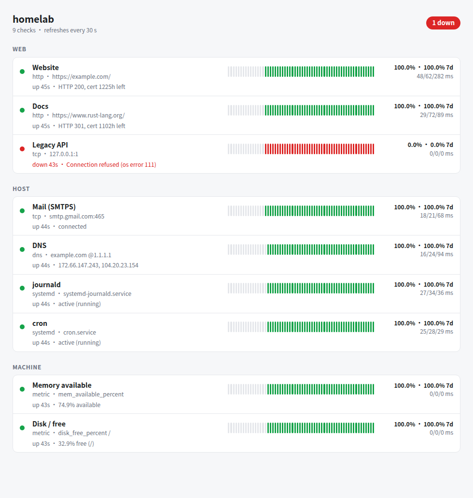

# pulse

**A tiny self-hosted health monitor.** One ~3 MB binary that idles at a few MB of RAM, configured
with one TOML file, with no database and no JavaScript. Each check runs on its own timer, you get
one status page, and you get an alert when something changes state.



## Why another monitor?

[Gatus](https://github.com/TwiN/gatus) and [Uptime Kuma](https://github.com/louislam/uptime-kuma)
are great and do much more. pulse is for when you want *less*:

- **Small:** about 3 MB on disk and 5–10 MB of RAM, a single static-ish binary, no runtime.
- **One file:** checks live in git next to the rest of your infrastructure, not in a web UI.
- **systemd-native:**
  - `Type=notify` and a watchdog;
  - API keys from `LoadCredentialEncrypted=`;
  - checks that a unit is active *and* hasn't restarted, which catches crash-loops;
  - runs fine under a strict sandbox.
- **Host-aware:** it can also watch the machine it runs on (memory, OOM kills, disks, read-only
  remounts and more), plus per-site traffic from Caddy.

It is small on purpose. Issues and PRs are welcome, but features that would make it big probably
won't be merged.

## Checks

| kind | OK when |
|---|---|
| `http` | Status is 2xx/3xx (or one of `expect_status`), the body contains `contains`, and the TLS certificate is valid for ≥ `cert_min_hours`. `resolve` pins the IP while keeping SNI and Host. |
| `tcp` | Connect succeeds; optionally the first bytes contain `banner` (e.g. `SSH-`). |
| `dns` | `query` resolves at `server`; optionally the answer includes `expect`. |
| `systemd` | The unit is `active` and its `NRestarts` didn't grow since the previous run. |
| `metric` | A machine metric is within `max`/`min` (see below). |
| `caddy` | A site's 5xx %, p95 latency and request rate are within bounds, read from Caddy's Prometheus endpoint. |

Every check also has:
- optional `interval_secs`, `timeout_secs`, `failure_threshold` and `max_latency_ms` overrides;
- the p50/p95/p99 of its own run time, shown on the page.

**Metrics** (`pulse --list-metrics`) come from `/proc`, `statvfs` and `nvidia-smi`. Rates average
over the time since the previous run.

| Area | Metrics |
|---|---|
| CPU | `cpu_percent`, `iowait_percent`, `steal_percent`, `load_per_core` |
| Memory | `mem_available_percent`, `swap_pages_per_sec`, `oom_kills` |
| Disk | `disk_free_percent`, `inodes_free_percent`, `mount_writable`, `disk_latency_ms`, `disk_queue` |
| Network | `net_drops_per_sec`, `net_errors_per_sec`, `tcp_retrans_percent`, `tcp_connections` |
| System | `fd_used_percent` |
| GPU | `gpu_util_percent`, `gpu_mem_percent`, `gpu_temp_c`, `gpu_throttle` |

Each metric has a sensible default bound.

**Caddy traffic** needs the global option `metrics { per_host }` in your Caddyfile. pulse reads
`http://127.0.0.1:2019/metrics` by default.

## Alerts

- A check goes **DOWN** only after `failure_threshold` consecutive failures (default 3). You get
  exactly one alert when it goes down and one when it recovers, so there's no flapping spam.
- **Channels:**
  - [ntfy](https://ntfy.sh) push;
  - email through [Resend](https://resend.com).
- **Heartbeat:** pulse pings a URL every minute, e.g. [healthchecks.io](https://healthchecks.io),
  so you also hear about it when the whole machine is gone.
- `pulse --test-alert` sends a test message on every configured channel.

## History

- **In memory:** the last 24 h of raw samples, plus hourly up/down counts for `retention_days`
  (default 7), which give the "7d" uptime.
- **On disk (optional):** with `data_dir` set, every sample is also appended to
  `<data_dir>/YYYY-MM-DD.jsonl` and reloaded on start. That's about 60 bytes per sample, because the
  detail text is written only when it changes. Older day files are deleted automatically. As a
  rough guide, 30 checks at 60 s take about 2.7 MB per day.

## Install

```bash
cargo build --release            # Rust >= 1.95
sudo install -m 0755 target/release/pulse /usr/local/bin/
pulse --check-config pulse.example.toml
```

See [`pulse.example.toml`](pulse.example.toml) for every option. pulse also serves `/api/status`
(JSON) and `/health`.

### systemd

```ini
[Unit]
Description=pulse health monitor
After=network-online.target
Wants=network-online.target

[Service]
Type=notify
WatchdogSec=60
ExecStart=/usr/local/bin/pulse -c /etc/pulse/pulse.toml
Restart=always
DynamicUser=yes
# history (data_dir = "/var/lib/pulse")
StateDirectory=pulse
# optional, for email: api_key_file = "$CREDENTIALS_DIRECTORY/resend"
LoadCredentialEncrypted=resend:/etc/pulse/resend.cred
ProtectSystem=strict
ProtectHome=yes
PrivateTmp=yes
NoNewPrivileges=yes
CapabilityBoundingSet=
MemoryDenyWriteExecute=yes
SystemCallFilter=@system-service
RestrictAddressFamilies=AF_INET AF_INET6 AF_UNIX

[Install]
WantedBy=multi-user.target
```

To store the Resend key encrypted, run
`systemd-creds encrypt --name=resend - /etc/pulse/resend.cred`, paste the key, then press Ctrl-D.

The status page has no authentication. Bind it to loopback (the default, `127.0.0.1:8097`) and put
a reverse proxy with TLS and access control in front of it.

## Design notes

- **Every `http` check is a fresh connection with a full TLS handshake.** There is no connection
  pooling and **no TLS session resumption**. A resumed session doesn't send the certificate again,
  so a monitor that resumes keeps checking the certificate it first saw after starting: it misses
  renewals, and it also misses real expiries. pulse learned this the hard way with Caddy's 12-hour
  internal certificates.
- Redirects are never followed; a 3xx counts as up unless you set `expect_status`.
- `systemd` checks only need read access to the system D-Bus, which every user has.
- `mount_writable` reads `/proc/1/mounts`, so the host's real mount flags are visible even inside
  a `ProtectSystem=` sandbox, where everything looks read-only. Don't use `ProtectProc=invisible`
  with that check.
- For email, `from = "… <onboarding@resend.dev>"` works without a verified domain, but it only
  delivers to your Resend account's own address.

## License

MIT
